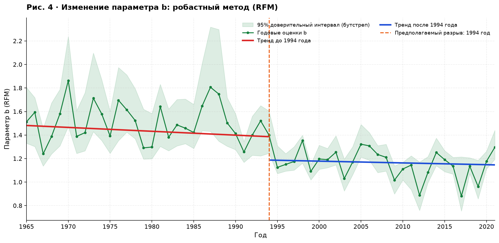
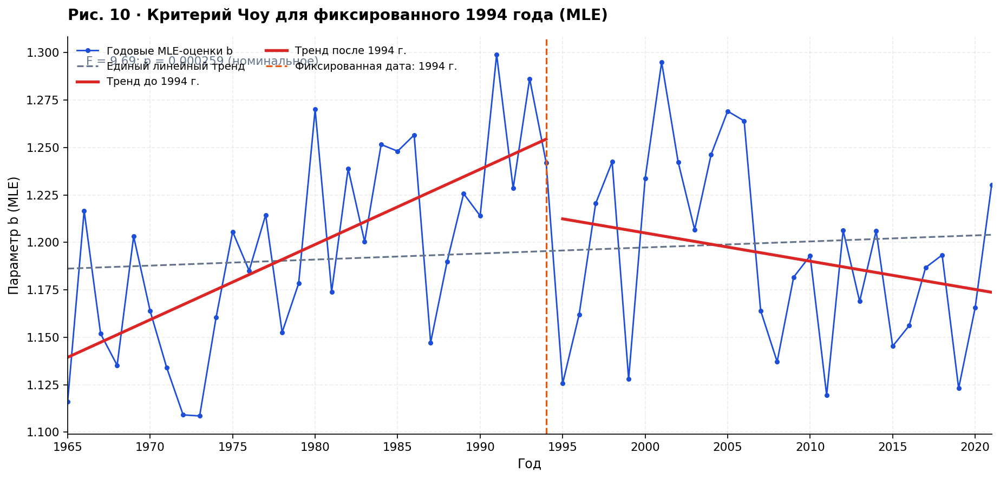

# Долговременная изменчивость параметра b закона Гутенберга–Рихтера

**Воспроизводимый анализ глобальной сейсмичности за 1965–2021 годы**  
RFM · MLE · supF · критерий Чоу · b-positive · каталоги ISC и NEIC

Проект сопровождает статью М. Р. Хакимовой и А. Б. Дерендяева «Долговременная изменчивость параметра b закона Гутенберга–Рихтера: статистическая значимость структурных изменений и чувствительность к методам оценивания».

## Быстрый запуск

Требуется **Python 3.10 или новее**. Нужна установка библиотек только один раз:

```bash
python -m pip install -r requirements.txt
python run.py
```

После выполнения:

- `figures/` содержит все **11 рисунков**, приведенные в статье с заголовками, осями и легендами;
- `results/rfm_годовые_оценки.csv` содержит годовые `Mc`, `a`, `b` и доверительные интервалы;
- `results/mle_годовые_оценки.csv` содержит оценки MLE при `M0 = 5.0`, `5.5`, `6.0`;
- `results/ИТОГИ_АНАЛИЗА.md` содержит результаты проверок и ограничения их интерпретации.

Для повторного построения по уже сохранённым годовым результатам:

```bash
python run.py --quick
```

По умолчанию supF-тест использует 19999 бутстреп-повторов; число можно изменить:

```bash
python run.py --n-boot 1999
```

Годовые 95% доверительные интервалы RFM используются для расчёта весов в supF-тесте.

По умолчанию интервалы загружаются из сохранённого файла `data/rfm_доверительные_интервалы.csv`.
Эти интервалы рассчитаны без ограничения бутстреп-оценок b диапазоном [0.5; 2.0].

Для повторного вычисления интервалов:
```
python run.py --recompute-ci
```
При пересчёте используется 1000 бутстреп-реплик на каждый год при фиксированной магнитуде полноты Mc. Учитываются все конечные оценки b. Границы 95% интервала определяются по 2.5-му и 97.5-му процентилям.

Результат сохраняется в `results/rfm_доверительные_интервалы_пересчёт.csv`.

При основной конфигурации supF (случайные блоки, L=3, 19999 повторений) получено: 1994 год, supF=7.1473, p=0.0457.

Чувствительность p для supF к длине блока, положению границ блоков и весам
(после `python run.py`, результат в `results/supf_чувствительность.md`):

```bash
python supf_sensitivity.py
```

## Состав репозитория

```text
Gutenberg_Richter_GitHub/
├── README.md                  # Как работать с проектом
├── РИСУНКИ.md                # Пояснения ко всем 11 рисункам
├── run.py                     # Один запуск: расчёты, тесты и графики
├── supf_sensitivity.py        # Чувствительность supF к блокам и весам
├── loader.py                  # Загрузчик ISC, сохранён и очищен от секретов
├── postgres.py                # Необязательное подключение к базе через окружение
├── requirements.txt           # Библиотеки Python
├── .gitignore                 # Исключения для Git
├── src/
│   ├── config.py              # Настройки и единое оформление
│   ├── gor.py                 # GOR-гомогенизация магнитуд к Mw
│   ├── rfm.py                 # RFM: расчёт a, b, Mc
│   ├── mle.py                 # MLE Аки для трёх магнитудных порогов
│   ├── bpositive.py           # b-positive по последовательным магнитудам
│   ├── statistics.py          # Критерий Чоу, supF, поправка Холма
│   └── plots.py               # Рисунки 1–11
├── data/                      # Исходные данные и компактные годовые итоги
├── figures/                   # Готовые русскоязычные изображения
├── results/                   # Годовые таблицы и статистический отчёт
└── tests/                     # Проверки корректности расчётов
```

## Основные результаты

| Метод | Характеристика | Полученный результат |
|---|---|---:|
| RFM + supF | Год максимума | 1994 |
| RFM + supF | Максимальное F | 7.1473 |
| RFM + supF | p (L=3, случайные блоки) | 0.0457 |
| RFM + supF | p при L=2–6, с весами | 0.0388–0.0618 |
| RFM + supF | p при L=2–6, без весов | 0.0927–0.1237 |
| MLE при M0 = 5,0 | F критерия Чоу | **9,6878** |
| MLE при M0 = 5,0 | Номинальное p | **0,000259** |
| MLE при M0 = 5,5 | Номинальное p | **0,00434** |
| MLE при M0 = 6,0 | Номинальное p | **0,0190** |

Максимум supF для RFM приходится на 1994 год, но его значимость **пограничная**. Значимость оценивается знаковым бутстрепом остатков блоками лет; разбиение на блоки генерируется заново в каждой псевдовыборке (средняя длина 3 года), поэтому результат не зависит от положения границ блоков. Прежняя схема с фиксированными блоками доступна как `block_scheme='fixed'` и даёт p = 0,0485. Дата для MLE была выбрана на этапе RFM по связанным данным, поэтому проверка Чоу **не является полностью независимой**. Метод b-positive не подтвердил согласованного глобального структурного разрыва около 1994 года. При повышенных магнитудных порогах NEIC обнаружен статистически значимый разрыв около 2006 года. Региональные результаты зависят от магнитудного порога. Статистический разрыв не следует автоматически считать физическим изменением глобального сейсмического режима.

## Региональная выборка для анализа b-positive

Для анализа **b-positive** использовались 20 наиболее сейсмически активных регионов из 50 укрупнённых зон Flinn–Engdahl. Схема районирования и принцип объединения 754 первичных регионов в 50 укрупнённых групп описаны в статье [«Flinn–Engdahl regionalization»](https://en.wikipedia.org/wiki/Flinn–Engdahl_regions) (Wikipedia, англ.). Регионы выбирались по количеству землетрясений в каталоге **NEIC (mb, M ≥ 3.5)** за 1973–2021 гг.

### Список регионов

| № | ID региона | Регион | Число событий |
|---|---|---|---:|
| 1 | 19 | Japan – Kuril Islands – Kamchatka Peninsula | 35 861 |
| 2 | 12 | Kermadec – Tonga – Samoa Basin Area | 29 936 |
| 3 | 8 | Andean South America | 27 736 |
| 4 | 24 | Sunda Arc | 26 330 |
| 5 | 15 | Bismarck and Solomon Islands | 20 294 |
| 6 | 23 | Borneo – Sulawesi | 18 946 |
| 7 | 1 | Alaska – Aleutian Arc | 18 260 |
| 8 | 14 | Vanuatu Islands | 17 799 |
| 9 | 18 | Guam to Japan | 16 437 |
| 10 | 22 | Philippine Islands | 16 140 |
| 11 | 16 | New Guinea | 15 650 |
| 12 | 13 | Fiji Islands Area | 14 923 |
| 13 | 46 | Andaman Islands to Sumatera | 11 853 |
| 14 | 30 | Middle East – Crimea – Eastern Balkans | 11 024 |
| 15 | 5 | Mexico – Guatemala Area | 10 166 |
| 16 | 48 | Hindu Kush and Pamir Area | 10 007 |
| 17 | 33 | Indian Ocean | 8 619 |
| 18 | 32 | Atlantic Ocean | 8 506 |
| 19 | 10 | Southern Antilles | 7 778 |
| 20 | 29 | Western Asia | 7 535 |

*ID соответствуют укрупнённым группам регионов Flinn–Engdahl.*

### Расчёт b-positive

Для каждого региона отдельно по годам рассчитывался b-positive на основе положительных разностей магнитуд последовательных землетрясений.

Расчёты проводились при порогах **M ≥ 3.5, M ≥ 4.0 и M ≥ 4.5**. Полученные значения объединялись в годовые медианы и взвешенные средние. Регионы с недостаточным количеством данных за отдельный год не учитывались.

Для трёх выборок NEIC используется единый минимальный порог положительных разностей ΔM_min = 0.2 при шаге округления магнитуд 0.1.

Сначала отбираются события по нижнему магнитудному порогу, затем по оставшейся временной последовательности заново вычисляются соседние разности.

## Рисунки

Краткие описания каждого рисунка находятся в [**РИСУНКИ.md**](РИСУНКИ.md).

| № | Рисунок | Раздел |
|---|---|---|
| 1 | [Частотно-магнитудное распределение](figures/01_частотно_магнитудное_распределение.png) | Закон Гутенберга–Рихтера |
| 2 | [Изменение Mc](figures/02_магнитуда_полноты_mc.png) | Полнота каталога |
| 3 | [Изменение параметра a](figures/03_параметр_a.png) | Сейсмическая активность |
| 4 | [Временная динамика b (RFM)](figures/04_динамика_b_rfm.png) | Робастное оценивание |
| 5 | [Зависимость F от предполагаемой даты](figures/05_тест_supf.png) | supF-тест |
| 6 | [NEIC: медианы b-positive](figures/06_bpositive_neic_медиана.png) | Чувствительность к порогам |
| 7 | [NEIC: взвешенные средние b-positive](figures/07_bpositive_neic_взвешенное.png) | Чувствительность к порогам |
| 8 | [ISC Mw: медиана и взвешенное среднее](figures/08_bpositive_isc_mw.png) | Сравнение каталогов |
| 9 | [Динамика b (MLE)](figures/09_динамика_b_mle.png) | Максимальное правдоподобие |
| 10 | [MLE: критерий Чоу для 1994 года](figures/10_критерий_чоу_mle.png) | Проверка даты |
| 11 | [MLE: три порога M0](figures/11_mle_разные_пороги.png) | Чувствительность результатов |

### Предпросмотр ключевых результатов





## Исходные данные и воспроизводимость

В `data/` лежит компактная поставка, достаточная для повторения расчётов и построения рисунков.

| Файл | Содержание |
|---|---|
| `isc_mw_1960_2021.csv.gz` | Гомогенизированные величины Mw и регионы; основной анализ ограничен 1965–2021 годами |
| `neic_mb_1973_2021.csv.gz` | Исходные магнитуды mb и регионы NEIC; записи начинаются в 1973 году |
| `rfm_доверительные_интервалы.csv` | Годовой ряд b с 95% доверительными интервалами |
| `rfm_кривая_F_из_статьи.csv` | Актуальная кривая F(T) для RFM без отсечения бутстреп-оценок |
| `bpositive_neic_итоги.csv` | Агрегированные региональные b-positive для порогов 3,5 / 4,0 / 4,5 |
| `bpositive_isc_итоги.csv` | Агрегированные региональные b-positive (все события / Mw ≥ 4,0) |

`run.py` заново рассчитывает RFM и MLE по ISC-каталогу. Таблицы b-positive взяты из финальной обработки и используются для иллюстраций 6–8; реализация оценивателя находится в `src/bpositive.py`.

Период анализа в статье — 1965–2021 годы. В ISC-каталоге есть записи до 1965 года, но расчёты RFM/MLE на них не распространяются. Каталог NEIC содержит записи начиная с 1973 года, поэтому региональные графики NEIC построены за 1973–2021 годы.

**Гомогенизация магнитуд к Mw.** Метод общей ортогональной регрессии реализован в `src/gor.py`. Функция `prepare_homogenized_catalog` формирует каталог с магнитудами Mw по заданным коэффициентам и приоритетам шкал, а `fit_gor_deming` позволяет оценить сами коэффициенты по парам магнитуд при известном отношении дисперсий ошибок. Коэффициенты и порядок приоритетов соответствуют использованным при построении каталога в `data/`, поэтому пересчёт Mw по готовым коэффициентам воспроизводится полностью.
Скрипт калибровки коэффициентов находится в `calibration/gor_calibration.py` и требует доступа к исходной PostgreSQL-базе через переменную окружения `EARTHQUAKE_DB_URL`. Без базы он неприменим и служит документацией происхождения коэффициентов.

Источники: [бюллетень ISC](https://www.isc.ac.uk/iscbulletin/), каталоги NEIC/USGS; метод b-positive — van der Elst (2021). При публикации данных и графиков сохраняйте ссылки на первоисточники и статью.

## Воспроизводимость региональных supF-тестов NEIC

Для каталога NEIC выполнены 60 региональных supF-тестов: 20 регионов Flinn–Engdahl для каждого из трёх магнитудных порогов: 3.5, 4.0 и 4.5.

Исходные регионально-годовые оценки:
`results/neic_regions/all_regions_b_values.csv`

Скрипт расчёта:
`scripts/neic_regional_supF_20x3.py`

### Исходный вариант

Невзвешенная регрессия, фиксированные календарные блоки длиной 3 года, 9999 бутстреп-повторений, seed=20261025.

Результаты:
`results/neic_regions/regional_supf_fixed_unweighted.csv`

Число значимых регионов после поправки Холма по 20 тестам: 1, 4, 14.

После совместной поправки по 60 тестам: 0, 3, 8.

### Контрольный вариант

Невзвешенная регрессия, случайные бутстреп-блоки со средней длиной 3 года, 9999 повторений, seed=20261025 с отдельным генератором для каждой пары (регион, магнитудный порог).

Результаты:
`results/neic_regions/regional_supf_random_unweighted.csv`

Число значимых регионов после поправки Холма по 20 тестам: 0, 1, 8.

После совместной поправки по 60 тестам: 0, 0, 3.

Различие результатов обусловлено схемой формирования бутстреп-блоков. Годы максимумов и наблюдаемые supF при одинаковой регрессии совпадают.

В обоих вариантах применено усечение диапазона кандидатов на разрыв на 15% с каждого конца ряда, с минимумом 5 наблюдений с каждой стороны.

Файлы *.meta.json сохраняют настройки запуска, версии программного окружения и SHA256 исходного CSV.