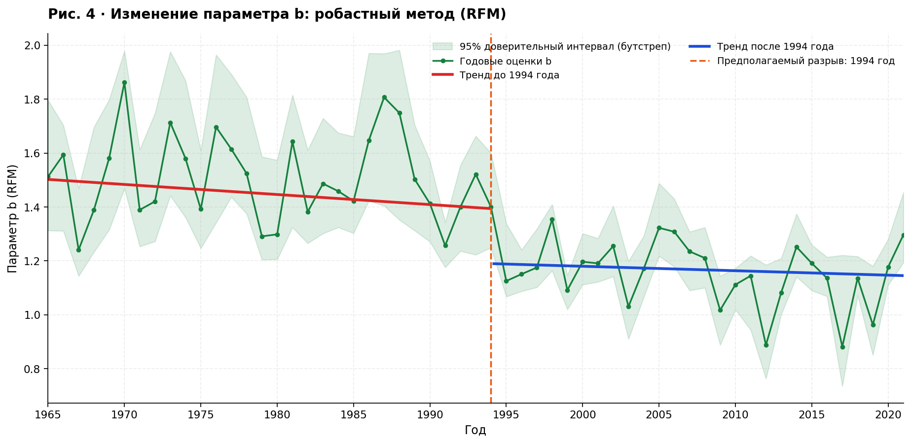
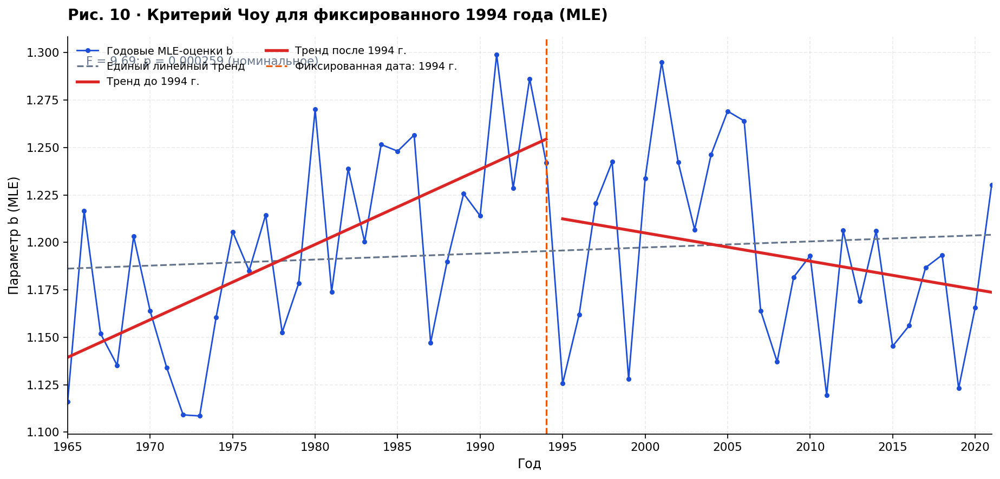

# Долговременная изменчивость параметра b закона Гутенберга–Рихтера

**Воспроизводимый анализ глобальной сейсмичности за 1965–2021 годы**  
RFM · MLE · supF · критерий Чоу · b-positive · каталоги ISC и NEIC

Проект сопровождает статью М. Р. Хакимовой и А. Б. Дерендяева «Долговременная изменчивость параметра b закона Гутенберга–Рихтера: статистическая значимость структурных изменений и чувствительность к методам оценивания».

## Быстрый запуск

Требуется **Python 3.10 или новее**. Нужна установка библиотек только один раз:

```bash
python -m pip install -r requirements.txt
python run.py
```

После выполнения:

- `figures/` содержит все **11 рисунков**, приведенные в статье с заголовками, осями и легендами;
- `results/rfm_годовые_оценки.csv` содержит годовые `Mc`, `a`, `b` и доверительные интервалы;
- `results/mle_годовые_оценки.csv` содержит оценки MLE при `M0 = 5.0`, `5.5`, `6.0`;
- `results/ИТОГИ_АНАЛИЗА.md` содержит результаты проверок и ограничения их интерпретации.

Для повторного построения по уже сохранённым годовым результатам:

```bash
python run.py --quick
```

Для увеличения числа бутстреп-повторов при проверке RFM:

```bash
python run.py --n-boot 19999
```

## Состав репозитория

```text
Gutenberg_Richter_GitHub/
├── README.md                  # Как работать с проектом
├── РИСУНКИ.md                # Пояснения ко всем 11 рисункам
├── run.py                     # Один запуск: расчёты, тесты и графики
├── loader.py                  # Загрузчик ISC, сохранён и очищен от секретов
├── postgres.py                # Необязательное подключение к базе через окружение
├── requirements.txt           # Библиотеки Python
├── .gitignore                 # Исключения для Git
├── src/
│   ├── config.py              # Настройки и единое оформление
│   ├── gor.py                 # GOR-гомогенизация магнитуд к Mw
│   ├── rfm.py                 # RFM: расчёт a, b, Mc
│   ├── mle.py                 # MLE Аки для трёх магнитудных порогов
│   ├── bpositive.py           # b-positive по последовательным магнитудам
│   ├── statistics.py          # Критерий Чоу, supF, поправка Холма
│   └── plots.py               # Рисунки 1–11
├── data/                      # Исходные данные и компактные годовые итоги
├── figures/                   # Готовые русскоязычные изображения
├── results/                   # Годовые таблицы и статистический отчёт
└── tests/                     # Проверки корректности расчётов
```

## Основные результаты

| Метод | Характеристика | Полученный результат |
|---|---|---:|
| RFM + supF | Наиболее вероятная дата | **1994** |
| RFM + supF | Максимальное F | **6,90** |
| RFM + supF | p (Wild-Block Bootstrap, 1999 повторов) | **0,0485** |
| MLE при M0 = 5,0 | F критерия Чоу | **9,6878** |
| MLE при M0 = 5,0 | Номинальное p | **0,000259** |
| MLE при M0 = 5,5 | Номинальное p | **0,00434** |
| MLE при M0 = 6,0 | Номинальное p | **0,0190** |

Максимум supF для RFM приходится на 1994 год, но его значимость **пограничная**. Дата для MLE была выбрана на этапе RFM по связанным данным, поэтому проверка Чоу **не является полностью независимой**. Региональный b-positive не дал сопоставимого устойчивого подтверждения после учёта множественных сравнений. Статистический разрыв не следует автоматически считать физическим изменением глобального сейсмического режима.

## Рисунки

Краткие описания каждого рисунка находятся в [**РИСУНКИ.md**](РИСУНКИ.md). Изображения сохранены в PNG и готовы для вставки в статью.

| № | Рисунок | Раздел |
|---|---|---|
| 1 | [Частотно-магнитудное распределение](figures/01_частотно_магнитудное_распределение.png) | Закон Гутенберга–Рихтера |
| 2 | [Изменение Mc](figures/02_магнитуда_полноты_mc.png) | Полнота каталога |
| 3 | [Изменение параметра a](figures/03_параметр_a.png) | Сейсмическая активность |
| 4 | [Временная динамика b (RFM)](figures/04_динамика_b_rfm.png) | Робастное оценивание |
| 5 | [Зависимость F от предполагаемой даты](figures/05_тест_supf.png) | supF-тест |
| 6 | [NEIC: медианы b-positive](figures/06_bpositive_neic_медиана.png) | Чувствительность к порогам |
| 7 | [NEIC: взвешенные средние b-positive](figures/07_bpositive_neic_взвешенное.png) | Чувствительность к порогам |
| 8 | [ISC Mw: медиана и взвешенное среднее](figures/08_bpositive_isc_mw.png) | Сравнение каталогов |
| 9 | [Динамика b (MLE)](figures/09_динамика_b_mle.png) | Максимальное правдоподобие |
| 10 | [MLE: критерий Чоу для 1994 года](figures/10_критерий_чоу_mle.png) | Проверка даты |
| 11 | [MLE: три порога M0](figures/11_mle_разные_пороги.png) | Чувствительность результатов |

### Предпросмотр ключевых результатов





## Исходные данные и воспроизводимость

В `data/` лежит компактная поставка, достаточная для повторения расчётов и построения рисунков.

| Файл | Содержание |
|---|---|
| `isc_mw_1960_2021.csv.gz` | Гомогенизированные величины Mw и регионы; основной анализ ограничен 1965–2021 годами |
| `neic_mb_1973_2021.csv.gz` | Исходные магнитуды mb и регионы NEIC; записи начинаются в 1973 году |
| `rfm_доверительные_интервалы.csv` | Годовой ряд b с 95% доверительными интервалами |
| `rfm_кривая_F_из_статьи.csv` | Опубликованные точки F-кривой для сверки |
| `bpositive_neic_итоги.csv` | Агрегированные региональные b-positive для порогов 3,5 / 4,0 / 4,5 |
| `bpositive_isc_итоги.csv` | Агрегированные региональные b-positive (все события / Mw ≥ 4,0) |

`run.py` заново рассчитывает RFM и MLE по ISC-каталогу. Таблицы b-positive взяты из финальной обработки и используются для иллюстраций 6–8; реализация оценивателя находится в `src/bpositive.py`.

Период анализа в статье — 1965–2021 годы. В ISC-каталоге есть записи до 1965 года, но расчёты RFM/MLE на них не распространяются. Каталог NEIC содержит записи начиная с 1973 года, поэтому региональные графики NEIC построены за 1973–2021 годы.

**Гомогенизация магнитуд к Mw.** Метод общей ортогональной регрессии реализован в `src/gor.py`. Функция `prepare_homogenized_catalog` формирует каталог с магнитудами Mw по заданным коэффициентам и приоритетам шкал, а `fit_gor_deming` позволяет оценить сами коэффициенты по парам магнитуд при известном отношении дисперсий ошибок. Коэффициенты и порядок приоритетов соответствуют использованным при построении каталога в `data/`, поэтому пересчёт Mw по готовым коэффициентам воспроизводится полностью.

Источники: [бюллетень ISC](https://www.isc.ac.uk/iscbulletin/), каталоги NEIC/USGS; метод b-positive — van der Elst (2021). При публикации данных и графиков сохраняйте ссылки на первоисточники и статью.
